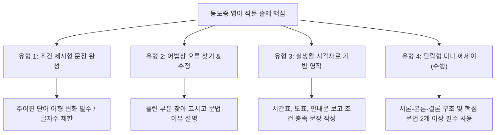

# 대구 동도중학교 영어 평가체계 및 출제경향 심층 분석 보고서

---

## 1. 학교 개요 및 학군적 특성

* **학교명**: 대구 동도중학교 (공립 남녀공학)
* **소재지**: 대구광역시 수성구 황금동 (범어·황금 학군 핵심 중학교)
* **채택 교과서**: **YBM (박준언 저)**
* **학군 특성**: 
  * 전국 최고 수준의 교육열과 학업 성취도를 자랑하는 대구 수성구 학군에 속함.
  * 특목고(대구과고, 대구외고, 자사고 등) 및 일반 명문고(경신고, 대륜고, 정화여고 등) 진학 비율이 매우 높음.
  * 단순한 기본 문법이나 본문 암기 수준을 벗어나, **고교 내신 및 수능 서술형으로 직결되는 심화 어법 적용력과 까다로운 조건부 영작 능력**을 지속적으로 요구함.

---

## 2. 학년별 영어 평가 구조 (3개년 로드맵)

### [1학년] 2022 개정 교육과정 & 자유학기제
* **평가 방식**: 지필고사(중간/기말) 미실시, **100% 과정중심 수행평가 및 포트폴리오 평가**
* **평가 영역 및 비중**:
  1. **단원별 조건 제시형 쓰기 (Writing Task / 40%)**: 단원별 핵심 문법(Target Grammar)을 반드시 활용하여 주어진 단어 수와 형식에 맞추어 글쓰기.
  2. **주제 중심 미니 에세이 및 발표 (Speaking & Writing Project / 30%)**: 자기소개, 학교생활 안내, 환경 보호 실천 계획 등 완결된 단락(Paragraph) 작성.
  3. **어휘 및 기초 문장 구성 포트폴리오 (Formative Assessment / 30%)**: 단원별 핵심 어휘, 어형 변형 훈련 워크시트 누적.
* **학교생활기록부 세특 연계**: 점수로 산출되지 않는 대신, '과목별 세부능력 및 특기사항(세특)'에 학생이 사용한 문법적 정교함, 작문 주제, 표현의 다양성이 구체적으로 기재됨.

### [2학년 & 3학년] 내신 지필평가 + 수행평가 체계
* **총점 반영 비율**: **지필평가 60% (중간고사 30% + 기말고사 30%) + 수행평가 40%**
* **지필평가 문항 구성**:
  * 객관식(선택형): 약 60~70% (20~22문항)
  * **서답형/서술형(주관식 영작): 약 30~40% (4~6문항)**
* **수행평가 구성**:
  * 쓰기 수행평가(20%): 제시된 시각 자료(표, 그래프, 상황 그림)를 보고 조건에 맞게 5~6문장의 요약문/제안문 작성.
  * 말하기/듣기 수행평가(20%): 작문한 스크립트를 기반으로 한 발표, 인터뷰 및 대구시 교육청 듣기평가.

---

## 3. 동도중학교 영어 서술형 및 작문 출제 4대 킬러 유형

수성구 내신 및 동도중학교 실제 기출을 분석했을 때 두드러지는 작문 출제 유형은 다음 4가지로 완벽히 정형화되어 있습니다.

### [유형 1] 고난도 조건 통제형 영작 (Condition-based Writing)
* **출제 패턴**: 우리말 해석과 함께 3~5개의 까다로운 조건을 부여함.
* **대표 조건 예시**:
  * `[조건 1]` <보기>에 주어진 단어만을 모두 사용할 것 (필요시 어형 변형).
  * `[조건 2]` 단원 목표 문법(예: to부정사의 부사적 용법, 비교급, 수여동사)을 반드시 1회 이상 포함할 것.
  * `[조건 3]` 축약형(don't, isn't 등)을 쓰지 말고 풀어서 쓸 것 (또는 정확히 총 8단어로 작성할 것).
* **학생들의 주요 감점 원인**: 어형 변형(study → studying, tall → taller) 누락, 3인칭 단수 -s 누락, 철자 오류.

### [유형 2] 밑줄 오류 수정 및 문법적 근거 작성 (Error Correction & Reason)
* **출제 패턴**: 학생이 쓴 것 같은 영문 일기나 대화문을 제시하고, 어법상 틀린 부분을 찾아 올바르게 고쳐 쓰도록 요구함.
* **고난도 변별 포인트**: "틀린 단어 2개를 찾아 기호를 쓰고 올바르게 고친 후, **그렇게 고친 이유를 우리말로 서술하시오.**"
* **채점 기준**: 수식 대상과의 관계, 동사의 형식(4형식→3형식 전환 전치사 to/for/of), 시제 일치 여부를 정확히 짚어야 만점 부여.

### [유형 3] 실생활 도표 및 시각 자료 기반 요약 영작 (Visual Data Transfer)
* **출제 패턴**: 영자 신문 기사 인포그래픽, 학교 축제 포스터, 기상청 주간 예보, 친구들의 취미 선호도 그래프 등을 제시.
* **출제 내용**: 두 대상을 비교급/최상급을 사용하여 비교하거나, 일정표를 보고 진행형/미래시제를 사용하여 문장 3개를 완성하도록 함.

### [유형 4] 수행평가 단락 에세이 (Paragraph Essay Rubric)
* **출제 패턴**: 1학년 자유학기제 및 2~3학년 수행평가 메인 과제.
* **요구 분량**: 4~7문장 내외 (단어 수 40~70단어).
* **구성 요건**:
  * Topic Sentence (주제문 1문장)
  * Supporting Sentences (구체적 근거 및 예시 3~4문장)
  * Concluding Sentence (마무리 요약 1문장)

---

## 4. 감점 없는 만점을 위한 필수 점검 규칙 (동도중 채점 기준)

동도중학교를 비롯한 수성구 중학교 채점단은 다음과 같은 사소한 실수에 가차 없이 감점(0.5점 ~ 1점)을 부여합니다.

1. **대소문자 및 문장 부호(Punctuation)**: 문장의 첫 글자 대문자, 고유명사 대문자, 마침표(.), 물음표(?) 누락 시 각 0.5점 감점.
2. **동사의 수 일치(Subject-Verb Agreement)**: 3인칭 단수 주어(He, She, My brother 등) 뒤 일반동사 `-s/-es` 누락은 최다 감점 요인.
3. **불규칙 과거/과거분사형 철자**: buy-bought, teach-taught, write-wrote-written 등의 철자 오류.
4. **명사의 단·복수 및 관사**: 셀 수 있는 명사 앞 `a/an`, 복수형 `-s/-es`, 셀 수 없는 명사에 s를 붙이는 오류.
5. **글자 수(Word Count) 위반**: "정확히 7단어로 쓰시오" 또는 "6단어 이상 10단어 이하" 조건을 어길 경우 해당 문항 부분 점수만 부여.
