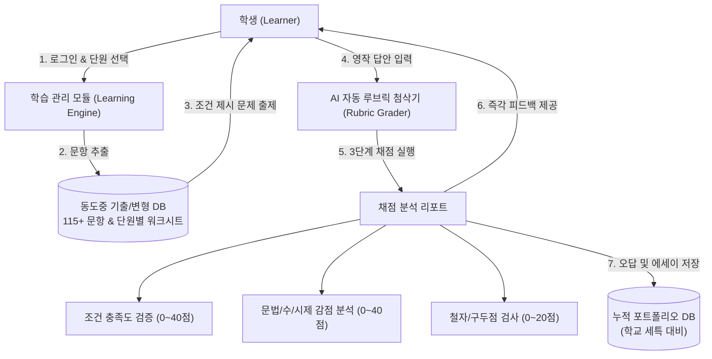

# 중학 3년 영어 작문 자기주도 자동학습 프로그램 아키텍처 설계서

---

## 1. 프로그램 개발 배경 및 목표
* **목표**: 대구 수성구 명문 중학교(동도중학교)의 까다로운 서술형 내신 및 수행평가 기준에 100% 맞춘 3개년 영작문 자동 훈련 시스템.
* **차별점**:
  * 단순한 문법 강의나 번역기 사용을 탈피.
  * **철저한 조건 통제형 영작(단어 수, 필수 문법, 어형 변화)** 출제.
  * 동도중학교 실제 채점 규정에 입각한 **0.5점/1.0점 단위 루브릭 자동 첨삭**.
  * 학생이 스스로 학원에 가지 않고도 자기주도적으로 매일 15~20분씩 3년간 실력을 누적할 수 있도록 설계.

---

## 2. 시스템 전체 구성도 (System Architecture)



---

## 3. 핵심 모듈별 기능 상세

### 1) 문항 출제 모듈 (Problem Generator)
* **모드 1: Daily Drilling (매일 10분)**
  * Type A(조건 영작) 2문항 + Type B(어법 오류 수정) 1문항 제공.
* **모드 2: Weekly Review (주말 30분)**
  * 한 단원 전체를 아우르는 워크시트(Step 1~4) 풀이.
* **모드 3: Performance Project (수행평가 대비)**
  * 학교 일정에 맞춘 Type D 단락 에세이 프로젝트 작성 및 집중 교정.

### 2) AI 루브릭 첨삭 엔진 (System Prompt Engine)
AI 모델이 학생 답안을 채점할 때 사용하는 표준 루브릭 시스템 프롬프트:

```markdown
당신은 대구 수성구 동도중학교의 엄격한 영어과 채점 교사입니다.
제시된 [문제], [조건], [학생 답안]을 바탕으로 다음 기준에 따라 엄정하게 채점하십시오.

[채점 가이드라인]
1. 총점 100점 만점으로 환산합니다.
2. 조건 누락 시 항목당 -10점.
3. 3인칭 단수 -s, 시제 불일치 등 문법 오류당 -5점.
4. 철자, 첫 글자 대소문자, 마침표/물음표 누락 시 -3점.

[출력 형식]
1. 최종 점수: OO / 100점
2. 감점 내역: (구체적 위치와 이유 명시)
3. 1:1 친절한 문법 코칭: (학생이 이해하기 쉬운 설명)
4. 원어민급 추천 업그레이드 문장: (동일한 의미를 더 세련되게 표현한 문장)
```

### 3) 학습 데이터 및 오답노트 관리 (Storage)
* 학생이 작성한 모든 답안과 AI의 첨삭 내역은 `student_history/` 디렉터리에 날짜별 마크다운/JSON으로 자동 저장.
* 누적된 에세이는 학기 말 **학교생활기록부 영어과 세부능력및특기사항(세특) 기재 참고자료**로 바로 출력 가능.

---

## 4. 3개년 단계별 마일스톤

| 시기 | 학년 / 학기 | 핵심 목표 | 도달 수준 |
| :---: | :---: | :--- | :--- |
| **Step 1** | **중1 1학기** | • 1~5형식 기초 문장 뼈대 확립<br>• 동사 수 일치 및 과거시제 실수 제로화 | 중학교 수행평가 글쓰기 기본 점수 100% 확보 |
| **Step 2** | **중1 2학기** | • 비교급, to부정사, 동명사, 수여동사 숙달<br>• 40~50단어 분량의 단락 에세이 완성 | 자유학기제 과정중심 평가 최고 수준(A) |
| **Step 3** | **중2 1~2학기** | • 관계대명사, 현재완료, 수동태, 5형식 사역/지각<br>• 지필평가 서술형 조건 영작 완벽 대비 | 동도중 지필평가 서술형 킬러 문항 만점 |
| **Step 4** | **중3 1~2학기** | • 가정법, 분사구문, 관계부사, 복합구문 완성<br>• 고교 수능 및 내신 1등급 서술형 선행 완성 | 수성구 명문고 영어 내신 1등급 기초 완성 |
